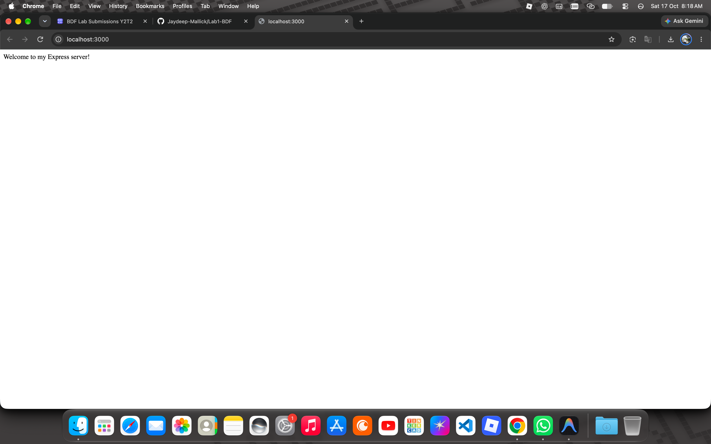
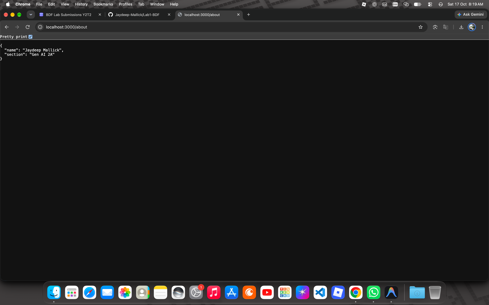
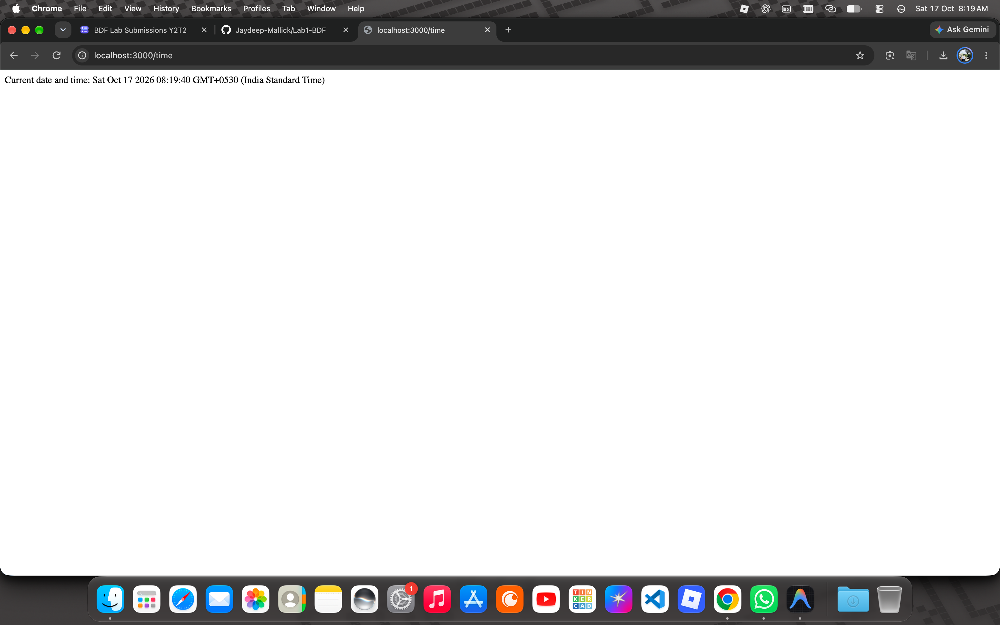
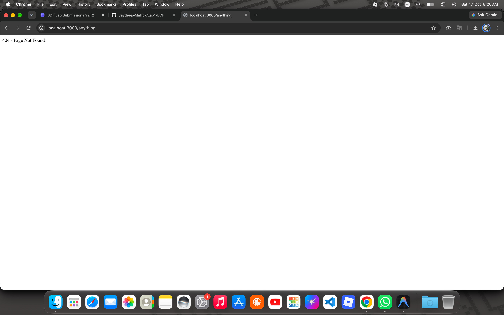

# Lab 1: Node.js and Express server

**Name:** Jaydeep Mallick · **Registration number:** 252U1R9047 · **Section:** Gen AI 2A

**Live link:** https://lab1bdf.vercel.app/

## How to run

Prerequisite: Node.js and npm installed. No environment variables are required (`PORT` is optional and defaults to 3000).

```bash
cd lab-01
npm install            # installs express into node_modules
node server.js         # Express server on http://localhost:3000
node server-http.js    # plain http-module server (stop the other one first, same port)
```

## Endpoints

| Method | Path     | Description                                  | Status |
| ------ | -------- | -------------------------------------------- | ------ |
| GET    | `/`      | Welcome text                                 | 200    |
| GET    | `/about` | JSON with name and section                   | 200    |
| GET    | `/time`  | Current date and time (`new Date()`)         | 200    |
| GET    | `/*`     | Any unknown path returns a "Not Found" message | 404  |

## Status codes observed

| Route        | Status code |
| ------------ | ----------- |
| `/`          | 200 OK |
| `/about`     | 200 OK |
| `/time`      | 200 OK |
| `/anything`  | 404 Not Found |

## Screenshots






## package.json fields explained

- **name**: project name (lowercase, no spaces)
- **version**: current version of the project
- **description**: short summary of what the project does
- **main**: entry-point file loaded when the package is required
- **scripts**: shortcut commands run with `npm run <name>` (`npm start`)
- **keywords**: search terms if the package is published
- **author**: who wrote it
- **license**: terms under which the code can be used
- **dependencies**: packages the project needs, added by `npm install express`

## Notes: problems faced and how I solved them

(Write your own here. Example: "Port 3000 was already in use when I started the second server, so I stopped the first with Ctrl+C.")
